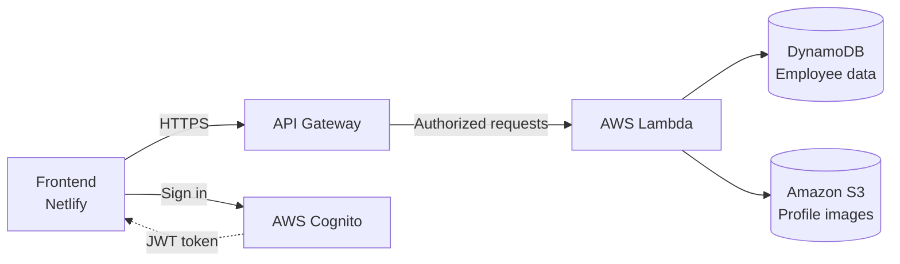

# NexusHR 🚀

**A full-stack, serverless employee management system built on AWS.**

[](https://nexushr-yash.netlify.app/)
[](https://drive.google.com/file/d/1RnF74NOCbjkwVvu_YX8uzdNp-fYwnEZk/view?usp=sharing)


🔗 **Live Demo:** [nexushr-yash.netlify.app](https://nexushr-yash.netlify.app/)
📄 **Full Documentation:** [View on Google Drive](https://drive.google.com/file/d/1RnF74NOCbjkwVvu_YX8uzdNp-fYwnEZk/view?usp=sharing)

---

## 📌 Overview

NexusHR is a cloud-native employee management application that provides secure authentication, complete employee record management (CRUD), and profile image handling, all through a clean, modern web interface.

The entire backend runs on managed AWS services with no servers to provision or maintain, making the system scalable, cost-efficient, and easy to operate.

---

## ✨ Features

| Feature | Description |
|---|---|
| 🔐 **Secure Authentication** | User sign-in and session management powered by AWS Cognito |
| 👥 **Employee Directory** | Browse all employees in a clean, easy-to-scan interface |
| ➕ **Add Employees** | Create new records with personal details and a profile photo |
| ✏️ **Update Records** | Edit existing employee information |
| 🗑️ **Delete Employees** | Remove employees by ID |
| 🖼️ **Profile Images** | Upload photos to S3 and display them throughout the app |
| ⚡ **Fully Serverless** | No servers to manage; scales automatically with demand |

---

## 🧠 Architecture



**Request flow**

1. The user signs in through **Cognito** and receives an authentication token.
2. The frontend sends requests to **API Gateway** with that token.
3. API Gateway invokes the relevant **Lambda** function.
4. Lambda reads and writes employee records in **DynamoDB** and handles profile images in **S3**.

---

## 🛠️ Tech Stack

### ☁️ Backend (AWS)

| Service | Role |
|---|---|
| **AWS Cognito** | Authentication and user management |
| **AWS Lambda** | Serverless backend compute |
| **Amazon API Gateway** | REST API endpoints |
| **Amazon DynamoDB** | NoSQL database for employee data |
| **Amazon S3** | Storage for employee profile images |

### 💻 Frontend

- HTML5
- CSS3
- JavaScript (vanilla)

### 🚀 Hosting

- **Frontend:** Netlify
- **Backend:** AWS (Lambda + API Gateway + DynamoDB + S3 + Cognito)

---

## 📁 Project Structure

> Adjust this to match your repository layout.

```
nexushr/
├── index.html        # Main page / employee directory
├── css/              # Stylesheets
├── js/               # Frontend logic and API calls
└── README.md
```

---

## ⚙️ Getting Started

### Prerequisites

- An AWS account
- A Cognito User Pool and App Client
- A DynamoDB table for employees
- An S3 bucket for profile images (with appropriate CORS configuration)
- Lambda functions deployed behind API Gateway

### Run the frontend locally

```bash
# Clone the repository
git clone https://github.com/<your-username>/<your-repo>.git
cd <your-repo>

# Serve the static files (any static server works)
npx serve .
```

### Configuration

Update the configuration values in your frontend code with your own AWS resources:

```javascript
const config = {
  apiBaseUrl: "https://<api-id>.execute-api.<region>.amazonaws.com/<stage>",
  cognito: {
    userPoolId: "<your-user-pool-id>",
    clientId: "<your-app-client-id>",
    region: "<your-aws-region>"
  }
};
```

> ⚠️ Never commit secrets or credentials. Cognito pool and client IDs are public identifiers, but IAM keys and similar secrets must stay out of the repository.

---

## 🚀 Deployment

| Layer | Platform |
|---|---|
| Frontend | Netlify |
| API | AWS API Gateway + Lambda |
| Database | Amazon DynamoDB |
| File storage | Amazon S3 |
| Authentication | AWS Cognito |

---
## 🔮 Future Improvements

- Search, filter, and pagination in the employee directory
- Role-based access control (admin vs. standard user)
- Infrastructure as Code (AWS SAM / CDK / Terraform)
- CI/CD pipeline for automated deployments
- Department and attendance management modules

---

## 🎯 Project Goals

This project was built to gain hands-on experience with:

- Designing cloud-native, serverless architectures
- Implementing authentication flows with AWS Cognito
- Integrating a frontend with real-world backend services
- Working with DynamoDB, S3, Lambda, and API Gateway together

---

## 👤 Author

**Yash Nimbalkar**
Computer Engineering student focused on cloud computing and full-stack development, with hands-on experience building serverless applications on AWS.

---

⭐ If you found this project useful, consider giving it a star!
